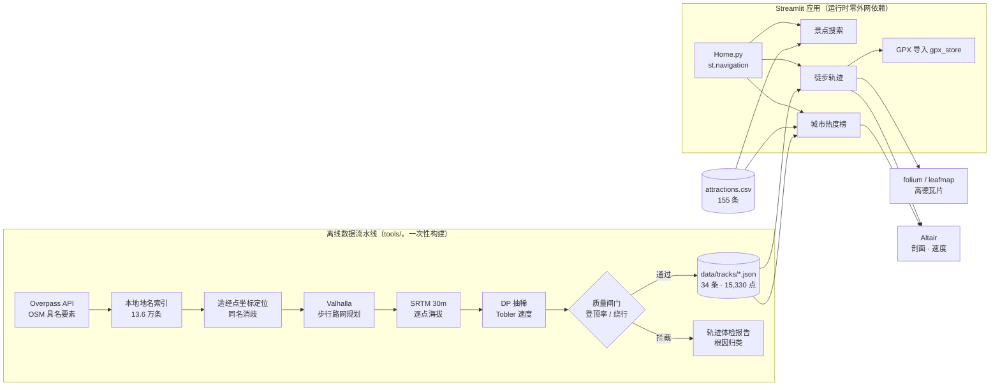

# 🗺️ 湘粤赣桂旅游与徒步地图

**一个把「去哪玩」和「这条路怎么走」做成可交互地图的 Web 应用。**

覆盖广东、湖南、江西、广西桂林：155 个景点 · 34 条徒步路线 · 15,330 个轨迹坐标点。

[](https://www.python.org/)
[](https://streamlit.io/)
[](LICENSE)
[](https://www.openstreetmap.org/)

[](https://south-china-hiking-map.streamlit.app)

> ### ▶ [**在线体验：south-china-hiking-map.streamlit.app**](https://south-china-hiking-map.streamlit.app)
>
> 不用装 Python、不用注册账号，点开就能用。
> 免费实例在 12 小时无访问后会休眠，打开时若看到 `Yes, get this app back up!`，点一下唤醒即可（约 30 秒）。

---

## 这个项目解决什么问题

计划一次华南旅行时，真正难的不是"知道有什么景点"，而是这三个问题：

| 问题 | 通用地图给不了 | 本项目怎么做 |
|---|---|---|
| 这个地方**值得去什么**？ | 只有评分和评论 | 每个景点写清「值得去的点」、门票、建议时长、最佳季节 |
| 这条徒步路线**中间经过哪、要走多久**？ | 只给一条示意线 | 贴着真实路网画轨迹，标出编号途经点、累计里程、海拔、坡度、预计耗时 |
| **先把哪个城市排进行程**？ | 无 | 按景点与路线资源算综合热度，横向排名 + 双维度散点 |

---

## 功能

### 🔍 景点搜索
- 地名 / 景点名 / 类型 / 最佳季节 模糊搜索，清空即看全部
- 热门城市快捷入口，可反复切换，当前城市高亮
- 省份、类型、最低热度三维筛选，与地图实时联动
- 地图圆点**按类型配色、按热度缩放**，自动生成图例
- 详情卡：值得去的点、门票、建议游玩时长、最佳季节、热度进度条、同城其他景点
- 当前筛选结果一键导出 CSV

### 🥾 徒步轨迹（核心）
- 四维筛选：省份 / 城市 / 难度 / 里程区间，按热度排序
- **双层描边轨迹线**（白描边 + 橙色主线），视觉接近户外 App
- **编号途经点**：起点绿「起」、终点红「终」、中间橙色序号，点击可跳转高德地图
- **高程剖面**：Altair 交互面积图，横轴累计里程、纵轴海拔，可缩放、可悬浮读数
- **速度曲线**：按坡度 + Tobler 徒步函数推算逐段速度，看出哪里会拖慢
- 路线指标：里程、累计爬升/下降、最高海拔、最陡坡度、Naismith 规则预计耗时
- 途经点表：序号 / 名称 / 累计里程 / 海拔
- **GPX 导出**：标准 GPX 1.1，可直接导入两步路、高德、户外助手
- **GPX 导入入库**：上传 → 解析 → 重算里程爬升 → 填元数据 → 落库，与内置路线并列
- **来源可信度分级**：列表标「🛰 实测 / 🗺 规划」，规划路径详情页明确警示，不冒充实测航迹

### 🔥 城市热度榜
- 景点表与路线表按归一化城市名关联（处理「深圳市大鹏新区」这类全称）
- 综合热度模型：`平均景点热度 × 0.5 + 规模分 × 0.3 + 平均路线热度 × 0.2`，权重理由写在页面上
- 排序条形图 + 观光 vs 徒步散点图 + 热度地图 + 明细表导出

### ⚙️ 离线数据流水线（`tools/`，页面运行时不依赖）

| 脚本 | 职责 |
|---|---|
| `fetch_osm_index.py` | 一次 Overpass 请求拉取华南 20–31°N 全部具名要素，建 13.6 万条本地地名索引（约 30 MB，不进仓库） |
| `osm_lookup.py` | 按名字 + 地理提示查坐标，带类型加权（峰顶 > 景点）避免同名误匹配 |
| `routes_manifest.py` | 47 条候选路线的唯一事实源：途经点、难度、季节、描述、公开主峰海拔 |
| `build_tracks.py` | 坐标 → 路网规划 → 海拔采样 → 速度推算 → 抽稀落盘 → 写回 CSV |
| `audit_tracks.py` | 离线体检：哪些路线没通过、为什么、归成 4 类根因 |
| `import_gpx_dir.py` | 整目录批量导入 GPX，支持 `--dry-run` |

---

## 技术架构



### 技术栈

| 层次 | 技术 | 解决什么 |
|---|---|---|
| 应用框架 | **Streamlit 1.66**（`st.navigation` 多页面） | 纯 Python 出 Web UI，无需前后端分离 |
| 地图渲染 | **leafmap / folium** | 瓦片底图、轨迹折线、自定义 DivIcon 标注、弹窗 |
| 底图服务 | **高德瓦片**（矢量 / 影像 / 注记）+ Carto | 国内直连、无需 API Key |
| 图表 | **Altair** | 高程剖面、速度曲线、排序条形图、散点图 |
| 数据处理 | **pandas / numpy** | 多表关联、分组聚合、筛选、格式化导出 |
| 空间数据 | **geopandas / pyogrio** | 省界 GeoJSON 读取（避开 GDAL 系统库依赖） |
| 路径规划 | **Valhalla pedestrian API** | 沿真实道路 / 步道的折线路径，替代两点直连 |
| 高程 | **SRTM 30m**（OpenTopoData） | 逐点真实海拔，算爬升、坡度、剖面 |
| 地理要素 | **Overpass API**（OpenStreetMap） | 具名峰顶、景点、古迹、村镇及其官方海拔 |
| 几何算法 | 自研 | haversine 距离、Douglas-Peucker 抽稀、Tobler 速度、Naismith 耗时 |
| 数据格式 | CSV / JSON / GPX(XML) | 轻量数据层，GPX 与主流户外 App 互通 |
| 工程化 | Git / GitHub / Docker | 版本控制、容器化部署 |

---

## 几个关键的技术决策

### 1. 用路网规划替代「两点直连」

最初的轨迹是两个景点之间的一条直线，完全没有参考价值。改成：途经点先用 OSM 官方坐标定位，
再用**步行路网路由**连起来，最后沿轨迹取 SRTM 30 m 海拔。生成的每个点是
`[lat, lon, ele, 累计公里]`，能看出盘山公路的之字形和山脊线。

中间做过一次对比测试并**放弃了 OSRM**：它在衡山把「祖师殿→高台寺」（直线 500 m）
绕成 **55 km**，因为 OSM 里那两段步道没连通；**Valhalla 给 1.24 km**，与实际相符。

### 2. 质量闸门：先验证指标有没有判别力

构建时会自动判废不可信的轨迹。但第一版判据是错的——用「实际里程 ÷ 直线距离」
当主要指标，结果**把真实登山线全拦了**：登山线天然「直线短、实际长」（盘山路），
七娘山（登顶率 98%）、西樵山（95%）、明月山（94%）都被误杀。

改法是把主判据换成**登顶率 = 轨迹最高点 ÷ 公开主峰海拔**（≥85% 放行），
绕行倍数只用于粗筛明显不连通的情况。结果 28 → 32 条，救回 4 条真实路线。

> 47 条候选里 34 条上架，13 条被拦下并归成 4 类根因（坐标写错 / OSM 无步道 /
> 只到半山 / 途经点重合），逐条见 [轨迹体检报告](轨迹体检报告.md)。

### 3. 承认边界：路网规划不等于实测航迹

OSM 在华南山区步道覆盖很稀，规划器只能沿公路和村道走，画出来会偏直、会绕远，
**达不到户外 App 那种一脚一脚的精度**。

所以补了 **GPX 导入**：从两步路 / 高德 / 手表导出实测轨迹，直接入库；
界面上明确区分「🛰 实测」与「🗺 规划」，不拿规划冒充实测。

### 4. 数据清洗：GPS 抖动会让爬升翻倍

导入的 GPX 海拔有 ±8 m 抖动，逐点求差累加后爬升被算成 **3118 m**（真值 1518 m）。
处理方式是先做 5 点滑动平均压噪，再设 3 m 死区（差值小于死区不累加也不更新基准，
避免缓慢爬升被吃掉），修正后 **1508 m，误差 < 1%**。

另外 `wpt`（独立路点）不能混进轨迹线——那是补给点、垭口，混进去轨迹会凭空跳几公里。
现在 `wpt` 单独提取成命名途经点，正好补上导入轨迹缺标注的问题。

### 5. 工程细节：一批「线上才会犯」的坑

| 现象 | 根因 | 处理 |
|---|---|---|
| 地图页崩 `UnicodeDecodeError: 'gbk' codec` | leafmap 的 `to_html()` 落盘后用不指定编码的 `open()` 读回，中文 Windows 默认 GBK | 改用 `m.get_root().render()` 直接拿 HTML，全程不落盘 |
| 地图整片灰 | folium 的 `{s}` 默认填 `a/b/c`，高德只认 `1/2/3/4` | 每个底图显式声明 `subdomains` |
| 底图重复叠加 | leafmap 建图默认塞一层 OSM | `tiles=None` 建图 |
| 点按钮「没反应」 | 直接给已实例化的 widget 赋值 → `StreamlitWidgetAlreadyInstantiatedError` | 改用 `on_click` 回调 + 独立 session key |
| 表格渲染不出来但测试无异常 | 某列混排文字与数字，pyarrow 类型推断失败 | 整列统一类型 |
| 缓存永不命中、每次刷新都联网 | `st.cache_data` 用内置 `hash()`，字符串 hash 每进程随机 | 改用 `hashlib.md5` 摘要做键 |

---

## 数据规模

| 指标 | 数值 |
|---|---|
| 景点 | **155** 条（粤 71 / 湘 55 / 赣 16 / 桂 13），13 个字段 |
| 徒步路线 | **34** 条（粤 12 / 湘 8 / 赣 10 / 桂 4） |
| 轨迹坐标点 | **15,330** 个，轨迹 JSON 合计 730 KB |
| 地名索引 | 13.6 万个具名要素，约 30 MB（本地构建，不进仓库） |
| 代码规模 | 3,708 行（运行时 1,859 + 离线工具链 1,849） |
| 几何校验 | 衡山 12.64 km / 爬升 1208 m，与实际景区里程 12 km 吻合 |

---

## 本地运行

```bash
pip install -r requirements.txt
streamlit run Home.py
```

Windows 上可直接双击 `start_local.bat`（用项目自带 `venv` 启动，固定 8531 端口）。

**注意**：必须用虚拟环境的解释器（`.\venv\Scripts\python.exe`），系统 Python 没装 streamlit。

## 部署上线

- **免费**：Streamlit Community Cloud → `share.streamlit.io` → Create app →
  选本仓库 / 分支 `master` / 主文件 `Home.py`，Advanced settings 里 Python 版本选 `3.12`
- **自建**：`docker build -t hiking-map . && docker run -d -p 8501:8501 --restart unless-stopped hiking-map`

完整步骤、验收清单、报错对照见 [部署手册](部署手册.md)。

---

## 目录

```
Home.py                 入口：全局配置 + 导航注册
app_utils.py            公共模块：底图、地图渲染、读表、GPX 解析、距离计算
gpx_store.py            GPX → 轨迹 JSON 入库（页面导入与批量脚本共用）
views/                  4 个页面
  ├─ 首页.py
  ├─ 景点搜索.py
  ├─ 徒步路线.py
  └─ 热度榜.py
data/
  ├─ attractions.csv    155 个景点
  ├─ hiking_routes.csv  34 条路线（由 tools 生成，勿手改）
  ├─ custom_routes.csv  导入的 GPX 路线
  └─ tracks/*.json      每条轨迹：坐标点、途经点、速度剖面、统计
tools/                  离线数据流水线（运行时不依赖）
.streamlit/config.toml  主题 / 无头模式 / 上传上限
requirements.txt        Python 依赖
Dockerfile              容器化部署
```

---

## 文档

| 文件 | 内容 |
|---|---|
| [部署手册](部署手册.md) | 从本机到公网：Git 提交、GitHub 推送、云平台部署、别人打不开怎么办 |
| [轨迹体检报告](轨迹体检报告.md) | 47 条候选路线逐条体检，13 条未通过的根因与解法 |

---

## 数据来源与可信度

- **景点**：整理自公开资料，门票为参考价，以景区公告为准。
- **轨迹**：路径与海拔是真实数据（OSM + SRTM），但 OSM 在部分山区步道录入不全，
  走位可能与现场有偏差，**导航请以现场路标和官方轨迹为准**。
- **热度**：综合估算指数（景区等级、知名度、可达性），**不是游客量统计**，仅用于排序参考。

## 致谢与许可

最初基于 [giswqs/streamlit-geospatial](https://github.com/giswqs/streamlit-geospatial) 的
MIT 模板起步，现已完全重写为中国华南文旅与徒步场景（数据、页面、轨迹流水线均为新增）。

代码以 [MIT License](LICENSE) 开源，保留原作者版权声明。
